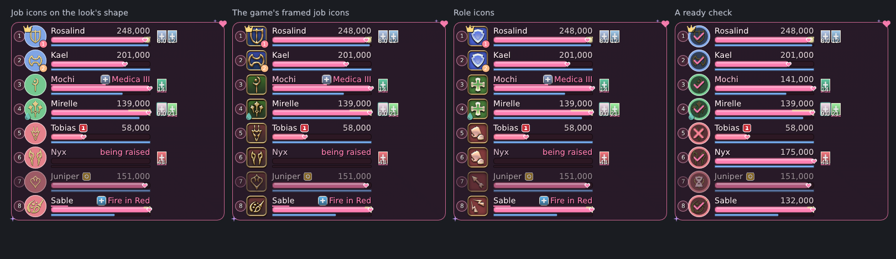
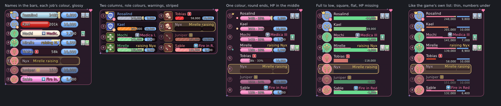
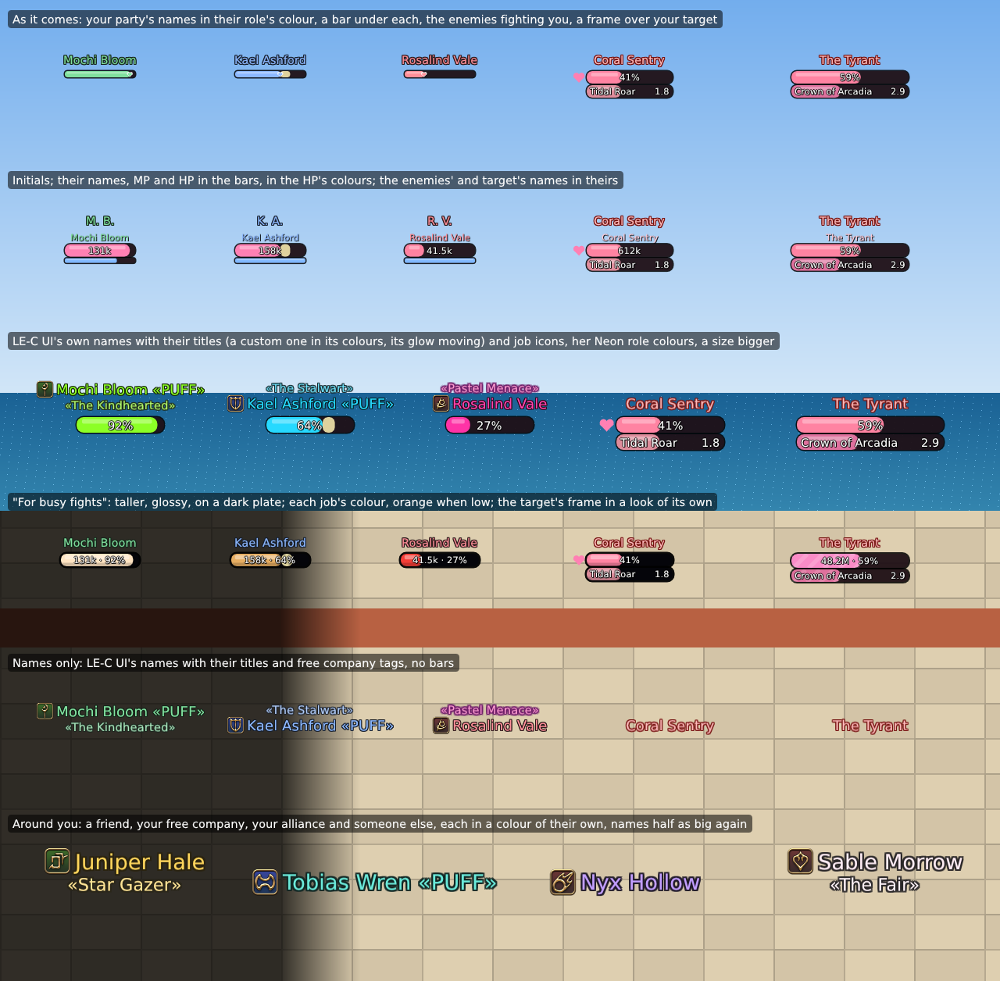

# LE-C UI

**Limsa E-Couple UI**: a Dalamud plugin that draws FINAL FANTASY XIV's HUD again in a look of your choosing (usual,
cute or edgy) without changing any of the game's settings. Made by Husk & Bone.


## Install

1. In game, type `/xlsettings` and open **Experimental**.
2. Under **Custom Plugin Repositories**, paste this link, press **+**, make sure it's ticked, then **Save and Close**:

   ```
   https://raw.githubusercontent.com/huskandbone/lecui-builds/main/repo.json
   ```

3. Type `/xlplugins`, search for **LE-C UI**, and press **Install**.
4. LE-C UI's Start page opens. **Use LE-C UI for my whole HUD** switches every piece on, each one where the game's own
   is in your HUD layout. Or switch pieces on one at a time.

Dalamud keeps it up to date from then on. You need the game started through XIVLauncher, with Dalamud (API 15).

## What it replaces

Each piece has its own switch. On, LE-C UI draws it where the game's own was and keeps the game's own off the screen.
Off, the game's own is back exactly where it was.

| Piece | What LE-C UI's does |
|---|---|
| Chat box | Tabs of your own; your chat colours from the game, or a colour of your own for any channel (start from the Pastel or Neon set); its own colours for the background, edge, tabs, times and the line you type in; names in colours of your choosing (as it comes, each in its channel's colour, so never black); clickable links: web addresses (it asks before one opens, showing the whole address; right-click one to copy it), items, quests and statuses (what they are when you point at them, and a menu to copy the name or see an item's market prices), Party Finder listings, map flags and names, the same in your tells and saved chat; drag across lines and press Ctrl+C to copy them, or right-click a line to copy it or select part of it; and right-click a name for the game's own menu for them (when they're near you or in your party; otherwise a small menu to send a tell, see your saved tells with them, or copy their name); the line you type in with its channel, and Enter opens it, as the game's does; an envelope by its cog opens your tells window, with how many are unread. Drag its tab row to move it any time; pull its sides or corner to size it while you're moving and sizing the pieces (`/lecui place`), so it never changes size by accident. Each channel keeps its own lines, so a fight's battle lines or a busy town's shouts never push your party's, free company's or tells' out. Commands, emotes, macros and tells all go through the game's own chat. In group pose it's out of the way until Enter opens its line, and goes again as the line closes (Enter sends it, Escape leaves it), so you can read and answer without it staying in your shots; or keep it there, or never show it there, on its page. |
| Party list | The game's order, HP and barriers with MP beside them and both numbers in their bars (as the game's own list has them), casts, statuses. Icons: job icons (or the game's framed ones, or roles), your chocobo's icon, party numbers, the leader's crown, signs over heads, ready check answers (bold green, red and grey marks, clear at a glance), who has the enemy's attention, cast icons, a mark for what Esuna removes. Who's raising whom: a fallen member's row lights up with the raiser's name (orange if two are raising the same person), and once they've been raised (an instant raise too) their row is boxed in green, "Insta raised by <name>" or "Raised by <name>", until they're back up. Statuses with no timer of their own (Kardia, Kardion) show none. In an alliance raid, which party you're in ("Alliance A", B or C) sits at the top of the list. Click to target, right-click for the game's menu, hover for `<mo>` macros. Plugins that move the mouse onto party members for mouseover actions can ask LE-C UI where its rows are, so they work with its list. Cross-world parties too: anyone near you as usual, everyone else with their job, level and the world they're on, faded only while they're away from you. Style it your way: the name over the bar or inside it, columns, each job's colour (or your role colours, one colour, or full to low), bars that turn redder as people are hurt, flat, soft, glossy or striped, square, rounded or slanted, a dark plate under them, and the HP written how and where you like, or **Like the game's own list** (thin bars, the numbers under them) in one click. |
| Duty list | The duty and its time and objectives, FATEs, the duty finder, the quests you follow. Click a quest to open it in the journal. |
| Job gauges | As the game has them for every job: the same windows (the second one its own piece), bars with their numbers, timers, pips and marks in each job's own shapes and colours. |
| You, your target, your focus target | HP and barrier, MP (with your MP's number over its bar), casts, statuses, your target's target. Right-click your target or focus target for the game's own menu. |
| Cast bar, statuses, enemy list, limit gauge, experience bar | All in the same look. |

Every piece is a box you can move and size, with its own background, size, shadow and border (borders can be switched off for one piece, or for all of them on the Look page). When the game's own right-click menus, yes/no questions, an adventurer plate or an examine window open over a piece, it fades out of their way and lets your mouse through. **Show and move every piece**
(the arrows on the settings window's title bar, or `/lecui place`) shows them all, with made-up contents where there's
nothing to show yet; hold Ctrl as you drag one to move them all together. The settings window minimizes to its title
bar, so you can watch the HUD while you change it.

| | |
|---|---|
|  |  |




*These pictures are made-up previews of LE-C UI's own drawing, not screenshots from the game.*

## Above heads (off until you switch it on)

One switch, on LE-C UI's Start page or its **Above heads** page (`/lecui heads`):
- **Names over heads**: the game's own names, restyled. Your party's names in their role's colour (yours too, if you
  like), shortened to first names, initials or their job if you like; your friends, your free company and your
  alliance each in a colour of their own (as it comes; pick the colours, or switch any off); your own name in a colour
  of its own if you like; and everyone else's in a colour of your own. Which names show at all is still up to the game's own Nameplates settings.
- **Or LE-C UI's own names** in their place (a switch): in your look, over every player around you (or just your
  party): their job's icon and their status icon (a mentor's crown, role-playing and the rest), their name, their free
  company's tag, and their title, over or under it as the game places it, in the colours above. Custom titles from
  Honorific show just as Honorific draws them, in their own colours with their moving glow, if you have it. They work
  even with the game's own names switched off, and switched off, the game's names are back.
- **Bars under the names**, in your look: over your party (HP and barrier; their MP, their name and numbers if you
  like), over the enemies fighting you in a dungeon (or every enemy near) with their HP, what they're casting (the ones
  you can interrupt pulse) and a mark on the ones you're holding, and a frame over your target (over anything, enemies
  only or people only), with their names written over the bars in place of the game's. They hold still over people
  standing around, and follow them when they mount up or sit down.
  They hide in cutscenes, group pose, with the UI hidden, and they go under the game's own HUD and windows (hotbars, chat, map, menus), as the game's own names do: only where the game actually draws something, never in its empty room. If a name ever looks cut where nothing is, `/lecui outline` (or "Outline what they go under", near the top of the Above heads page) outlines every piece of the game's UI it goes under, with its name, and saves what it found as `outline.txt` in LE-C UI's settings folder. In busy places, nearer names sit over farther ones, and far names and names behind a nearer one are drawn fainter, so a crowd's names don't knot together ("Tidier in busy places", on as it comes; names show out to 50 yalms, which you can change). Style them like the party list,
  give your target's frame a look of its own, or switch the bars off for names only; **For busy fights** makes them
  taller and glossy on a dark plate, so they stand out in a raid.
- **Sharp writing** (new, a switch): names and numbers over heads drawn from big fonts, so they stay crisp however big
  you set them, and LE-C UI's names in a font of your choice: the game's own (AXIS, Jupiter, Trump Gothic, Miedinger),
  Dalamud's (Clean, Light, Mono), or any font on your computer through Dalamud's font chooser, made at every size the
  names are drawn at, with a sharpness slider.
  It's only used once you're logged in, so you can always switch it off at the title screen.
- **The edge round the names**: thinner, none, or wider, and black or a colour of your own instead of a shade of each
  name's colour; or an edge of its own for each name colour (your friends', your free company's, your alliance's,
  everyone else's, your own, and each role's).
- **Role colours** of your own for tanks, healers and damage dealers (start from the game's, Pastel, Neon or Jewels),
  used by the names, the bars and the party list.

Switch it off and the game's own names are back at once. If the game's own HP bars on names are switched on too
(Character Configuration, UI Settings, Nameplates), they're left out over anyone with one of LE-C UI's bars (as it
comes), or under every name if you like. Over the enemies it draws bars over, LE-C UI writes their names in place of
the game's (as it comes; a switch). Only what's shown changes: your game's settings stay exactly as they are.



*A made-up preview of LE-C UI's own drawing, not a screenshot from the game.*

## Tells window (on from the start)

Your tells get a window of their own: a conversation for each person, with a line to answer on. It pops up when a tell
comes in or when you send one (on that conversation), without taking your keyboard, and waits until after a fight or a
cutscene. `/lecui tells` opens it. Type an emote there (/hug, /em ...) and it runs, as from the game's own chat line. **History** on a conversation opens every saved tell with that person, day by day,
with a search. Switch the window off on LE-C UI's Start page or its Chat box page (**Tells window**).

The conversations are kept for next time: log out, restart the game or update LE-C UI, and the people you're talking to
are still there, with what's been said and what's unread (and the window's open again if it was). Each of your
characters has its own, kept in a file on your computer only (`pluginConfigs\LECUI\Tells`), never sent anywhere;
closing a conversation lets it go. Switch **Keep the conversations for next time** off (Chat box page, Tells window) and
the kept ones are removed.


*A made-up preview of LE-C UI's own drawing, not a screenshot from the game.*

## Saved chat (on from the start, kept for good)

Your tells are kept in a plain text file a day on your computer (`pluginConfigs\LECUI\ChatLogs`), never sent anywhere,
for good unless you pick a shorter time. You can save other channels too (party, FC, linkshells...). `/lecui history`
reads them back, with a search. Switch it off, or pick the channels and how long to keep them, on LE-C UI's Chat box
page (**Saved chat**); the Start page has its switch too. Switched off, nothing more is written; what's saved stays until
you delete it there.

## Your settings stay yours

- **Nothing of the game's settings is ever written.** Your HUD layouts, character and system configuration, chat log
  settings and keybinds are left exactly as they are. Every build is checked for this: its code is read for anything
  that sets a game setting, a HUD layout or a game window's own position, size or visibility, and it uses no hooks and
  no signature scans.
- **Nothing it does is saved into the game.** The game's own pieces are only drawn off the screen while LE-C UI's are
  on; their positions in your HUD layout are never touched. With Above heads on, the names over heads are restyled as
  the game writes each one (through Dalamud), and nothing of that is saved: switched off, they're the game's own.
- **The game's own pieces come back** the moment you switch a piece off, whenever the HUD layout editor is open (so
  the layout you save there is your own), when you log out, and when LE-C UI is disabled or uninstalled.
- **One other plugin is only asked one thing**: with LE-C UI's own names and their titles on, Honorific (if you have
  it) is asked for people's custom titles. Nothing is ever sent to it or changed in it.
- **Other plugins can ask LE-C UI two things, and are only answered**: where its party list's rows are (for mouseover
  tools) and which look is on (so something drawn over the game can match it). Nothing another plugin asks changes
  anything in LE-C UI or in the game.
- **Your HUD changes only when you say so**: LE-C UI starts with every piece of the HUD off, and Above heads too. Two
  things are on from the start, with their switches on the Start page: the tells window (its conversations kept on your
  computer for next time), and saving your tells on your computer.
- **Your LE-C UI settings survive updates**: each new version keeps a copy of them from before it.

## Going back

- `/lecui off all`, or **The game's own HUD again** on LE-C UI's Start page.
- Or disable or uninstall LE-C UI in `/xlplugins`: the game's HUD is exactly as it was.
- LE-C UI's own settings are in `%AppData%\XIVLauncher\pluginConfigs\LECUI.json`, with copies from before each update
  in `pluginConfigs\LECUI\`.

## Commands

| Command | What it does |
|---|---|
| `/lecui` | LE-C UI's settings |
| `/lecui place` | Show, move and size every piece that's on (again to lock them) |
| `/lecui history` | Saved chat: your saved tells, and any other channels you save |
| `/lecui tells` | The tells window |
| `/lecui heads` | The names and bars over heads |
| `/lecui outline` | Outline what the names over heads go under (the game's UI, with each piece's name): again to stop |
| `/lecui on <piece>` / `/lecui off <piece>` | Switch a piece on or off: chat, party, duty, gauge, gauge2, player, target, focus, cast, statuses, enemies, limit, exp, heads (the names and bars over heads), or all |
| `/lecui usual`, `/lecui cute`, `/lecui edgy` | Switch the look |

## For plugin makers

LE-C UI answers two Dalamud plugin calls (IPC), each a function giving back a `double[]`
(`GetIpcSubscriber<double[]>(name).InvokeFunc()`). They're only answered: nothing you call changes anything.

- `LECUI.PartyList.Rows`: nine numbers for each member drawn on LE-C UI's party list, in the order drawn: their entity
  ID, the row's left, top, width and height, then their name's left, top, width and height, in the game window's own
  pixels (the screen's, less ImGui's main viewport position). Empty while the list isn't drawn. Hovering a row makes
  that member the game's mouseover target.
- `LECUI.Look`: forty numbers (layout 1): [0] the layout's version; [1] the look (0 usual, 1 cute, 2 edgy); [2-21] the
  accent, second, writing, quiet writing and low-HP colours it draws over the game with (red, green, blue, alpha, 0 to
  1); [22] little drawings on; [23] hearts (cute) or slashes (edgy) among them; [24] sparkles (cute) or cut corners
  (edgy); [25] their size; [26] how round the corners are; [27] edgy headings in capitals; [28-39] the tank, healer and
  damage colours. Later layouts only add numbers at the end.

## Something wrong?

LE-C UI is new. If the party list, the duty list or a job gauge shows something different from the game's own, open
its settings page, copy **What the game holds for it**, and send it with an issue here. A piece that fails stops by
itself and gives you the game's own back.

FINAL FANTASY XIV © SQUARE ENIX CO., LTD. LE-C UI is a fan-made plugin, not affiliated with or endorsed by Square Enix.
