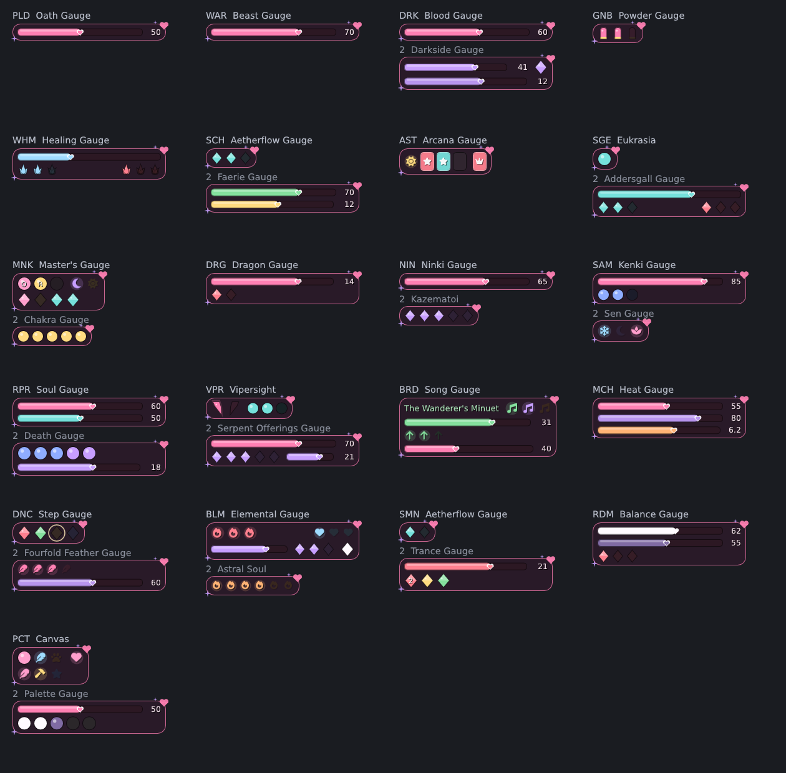

# LE-C UI

**Limsa E-Couple UI**: a Dalamud plugin that draws FINAL FANTASY XIV's HUD again in a look of your choosing (usual,
cute or edgy) without changing any of the game's settings. Made by Husk & Bone.


## Install

1. In game, type `/xlsettings` and open **Experimental**.
2. Under **Custom Plugin Repositories**, paste this link, press **+**, make sure it's ticked, then **Save and Close**:

   ```
   https://raw.githubusercontent.com/huskandbone/lecui-builds/main/repo.json
   ```

3. Type `/xlplugins`, search for **LE-C UI**, and press **Install**.
4. LE-C UI's Start page opens. **Use LE-C UI for my whole HUD** switches every piece on, each one where the game's own
   is in your HUD layout. Or switch pieces on one at a time.

Dalamud keeps it up to date from then on. You need the game started through XIVLauncher, with Dalamud (API 15).

## What it replaces

Each piece has its own switch. On, LE-C UI draws it where the game's own was and keeps the game's own off the screen.
Off, the game's own is back exactly where it was.

| Piece | What LE-C UI's does |
|---|---|
| Chat box | Tabs of your own, your chat colours, names in colours of your choosing, clickable links (map flags, names), the line you type in with its channel; Enter opens it, as the game's does. Drag its tab row to move it and pull its edges to size it, any time. Commands, emotes, macros and tells all go through the game's own chat. |
| Party list | The game's order, HP and barriers, MP, casts, statuses. Icons: job icons (or the game's framed ones, or roles), your chocobo's icon, party numbers, the leader's crown, signs over heads, ready check answers, who has the enemy's attention, cast icons, a mark for what Esuna removes. Who's raising whom: a fallen member's row lights up with the raiser's name (orange if two are raising the same person). Click to target, right-click for the game's menu, hover for `<mo>` macros. |
| Duty list | The duty and its time and objectives, FATEs, the duty finder, the quests you follow. Click a quest to open it in the journal. |
| Job gauges | As the game has them for every job: the same windows (the second one its own piece), bars with their numbers, timers, pips and marks in each job's own shapes and colours. |
| You, your target, your focus target | HP and barrier, MP, casts, statuses, your target's target. |
| Cast bar, statuses, enemy list, limit gauge, experience bar | All in the same look. |

Every piece is a box you can move and size, with its own background, size and shadow. **Show and move every piece**
(the arrows on the settings window's title bar, or `/lecui place`) shows them all, with made-up contents where there's
nothing to show yet; hold Ctrl as you drag one to move them all together. The settings window minimizes to its title
bar, so you can watch the HUD while you change it.

| | |
|---|---|
|  |  |


*These pictures are made-up previews of LE-C UI's own drawing, not screenshots from the game.*

## Saved chat (only if you want it)

Off until you switch it on (LE-C UI's settings, Chat box page, **Saved chat**). Then your tells, and any other channels
you pick, are kept in a plain text file a day on your computer (`pluginConfigs\LECUI\ChatLogs`), never sent anywhere,
for as long as you choose. `/lecui history` reads them back, with a search.

## Tells window (only if you want it)

Off until you switch it on (LE-C UI's settings, Chat box page, **Tells window**). Then your tells get a window of their
own: a conversation for each person, with a line to answer on. It pops up when a tell comes in, without taking your
keyboard, and waits until after a fight or a cutscene. `/lecui tells` opens it.

## Your settings stay yours

- **Nothing of the game's settings is ever written.** Your HUD layouts, character and system configuration, chat log
  settings and keybinds are left exactly as they are. Every build is checked for this: its code is read for anything
  that sets a game setting, a HUD layout or a game window's own position, size or visibility, and it uses no hooks and
  no signature scans.
- **Nothing it does is saved into the game.** The game's own pieces are only drawn off the screen while LE-C UI's are
  on; their positions in your HUD layout are never touched.
- **The game's own pieces come back** the moment you switch a piece off, whenever the HUD layout editor is open (so
  the layout you save there is your own), when you log out, and when LE-C UI is disabled or uninstalled.
- **Nothing changes until you say so**: LE-C UI starts with every piece off.
- **Your LE-C UI settings survive updates**: each new version keeps a copy of them from before it.

## Going back

- `/lecui off all`, or **The game's own HUD again** on LE-C UI's Start page.
- Or disable or uninstall LE-C UI in `/xlplugins`: the game's HUD is exactly as it was.
- LE-C UI's own settings are in `%AppData%\XIVLauncher\pluginConfigs\LECUI.json`, with copies from before each update
  in `pluginConfigs\LECUI\`.

## Commands

| Command | What it does |
|---|---|
| `/lecui` | LE-C UI's settings |
| `/lecui place` | Show, move and size every piece that's on (again to lock them) |
| `/lecui history` | Saved chat, if you've switched it on |
| `/lecui tells` | The tells window, if you've switched it on |
| `/lecui on <piece>` / `/lecui off <piece>` | Switch a piece on or off: chat, party, duty, gauge, gauge2, player, target, focus, cast, statuses, enemies, limit, exp, or all |
| `/lecui usual`, `/lecui cute`, `/lecui edgy` | Switch the look |

## Something wrong?

LE-C UI is new. If the party list, the duty list or a job gauge shows something different from the game's own, open
its settings page, copy **What the game holds for it**, and send it with an issue here. A piece that fails stops by
itself and gives you the game's own back.

FINAL FANTASY XIV © SQUARE ENIX CO., LTD. LE-C UI is a fan-made plugin, not affiliated with or endorsed by Square Enix.
